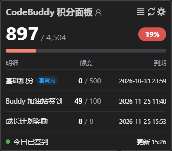

# CodeBuddy Quota

[简体中文](README.md) | [English](README.en.md)

Show your CodeBuddy credit balance in the status bar; hover to open the credit panel

## Installation

Search for **CodeBuddy Quota** in your editor's marketplace

You can also download the `.vsix` from [Releases](https://github.com/GhostCmdr/codebuddy-quota/releases/latest) and install it manually

## Notes

1. Install and sign in to Tencent Cloud CodeBuddy (`tencent-cloud.coding-copilot`) in VS Code or the VS Code-based IDE you are using
2. This extension supports VS Code-based editors only; tested with VS Code, VSCodium, Cursor, Windsurf, Kiro, CodeBuddy IDE, Trae Code, Qoder IDE and CodeArts IDE
3. The extension reads the session saved by that extension from the **editor currently in use**, so there is no need to copy cookies or tokens manually

   When no session can be read, paste an accessToken into `codebuddyquota.manualToken` as a fallback

   To clear the manual input, run the command CodeBuddy Quota: 清除保管箱里的手动 Token

## Features

- Status bar shows remaining credits live; click the status bar to refresh manually
- Hover panel: total remaining with percentage, per-pack detail and the current account; adapts to all themes
- Open the extension settings, refresh credits, or jump to the web usage page right from the panel
- Pack names and credit formatting match the web UI
- Works with both China and international accounts, and follows account switches
- Scheduled auto-refresh

## Settings

| Setting | Default | Description |
|---|---|---|
| `codebuddyquota.refreshInterval` | 30 | Auto-refresh interval in minutes, 0 disables |
| `codebuddyquota.autoCheckin` | true | Daily check-in |
| `codebuddyquota.autoTravel` | true | Auto Buddy Travel |
| `codebuddyquota.detailRows` | 3 | Number of packs to show, 1~6 |
| `codebuddyquota.planPackFirst` | true | Plan pack first: subscription pack first with an "Included" tag, unlimited packs second, others by expiry; when off, unlimited packs still go first |
| `codebuddyquota.region` | auto | Credits API region: `auto` follows the signed-in account; `cn` / `intl` forces it |
| `codebuddyquota.manualToken` | empty | Manual accessToken, used only when the editor session cannot be read; entered once, moved into the encrypted secret store and this field is cleared. When a session can be read it takes precedence, and the manual token is kept as a backup |

## Commands

| Command | Effect |
|---|---|
| `CodeBuddy Quota: 刷新积分` | Refresh the credits panel |
| `CodeBuddy Quota: 立即签到` | Check in manually |
| `CodeBuddy Quota: 清除保管箱里的手动 Token` | Remove the manual token kept as a fallback |

## Privacy

Credentials are read only from your machine and sent only to the official workbuddy.cn / codebuddy.cn / codebuddy.ai domains; nothing is logged or uploaded. The manual token is stored in the encrypted secret store, leaving no plaintext in settings

## License

[MIT](LICENSE)
