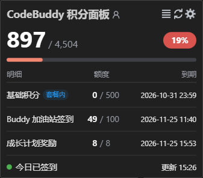

# CodeBuddy Quota

[简体中文](README.md) | [English](README.en.md)

在状态栏显示 CodeBuddy 积分额度，鼠标悬停查看积分面板浮窗

## 安装

在当前编辑器的扩展市场搜索 **CodeBuddy Quota**

也可从 [Releases](https://github.com/GhostCmdr/codebuddy-quota/releases/latest) 下载 `.vsix` 自行安装

## 注意事项

1. 请先在VS Code或当前使用的vs系IDE中安装 Tencent Cloud CodeBuddy（`tencent-cloud.coding-copilot`）并登录
2. 本扩展暂时只适配了VS系编辑器，已适配编辑器有：VS Code、VSCodium、Cursor、Windsurf、Kiro、CodeBuddy IDE、Trae Code、Qoder IDE、CodeArts IDE
3. 本扩展自动从**当前所用编辑器**读取该扩展保存的登录态，无需手动复制 Cookie或Token

   当读不到登录态时，请通过设置项 `codebuddyquota.manualToken` 里填入 accessToken 兜底使用

   如需清空手动输入，请执行命令 CodeBuddy Quota: 清除保管箱里的手动 Token

## 功能

- 状态栏实时显示剩余积分，可点击状态栏进行手动刷新
- 悬停积分浮窗：剩余总量与占比 + 积分包明细 + 当前账号，已经适配各种主题
- 可直接在浮窗面板中直接打开插件设置、刷新积分情况、跳转网页用量页
- 积分包名称、额度写法与网页端基本一致
- 国内版、国际版账号都能取数，切换账号后自动跟随
- 定时自动刷新

## 设置

| 设置 | 默认 | 说明 |
|---|---|---|
| `codebuddyquota.refreshInterval` | 30 | 自动刷新间隔（分钟），0 关闭 |
| `codebuddyquota.autoCheckin` | true | 自动每日签到 |
| `codebuddyquota.autoTravel` | true | 自动喵喵旅行 |
| `codebuddyquota.detailRows` | 3 | 积分包显示数量，1~6 |
| `codebuddyquota.planPackFirst` | true | 订阅套餐置顶：订阅套餐排第一并标注「套餐内」、不限量包排第二，其他积分包按到期升序；关闭时不限量包仍置顶 |
| `codebuddyquota.region` | auto | 积分接口区域：auto 按登录态自动判断，也可强制 `cn` 国内 / `intl` 国际 |
| `codebuddyquota.manualToken` | 空 | 手动 accessToken。只在当前编辑器读不到登录态时兜底使用；填一次即收进加密保管箱并清空本项 |

## 命令

| 命令 | 作用 |
|---|---|
| `CodeBuddy Quota: 刷新积分` | 刷新积分面板 |
| `CodeBuddy Quota: 立即签到` | 手动进行补签 |
| `CodeBuddy Quota: 清除保管箱里的手动 Token` | 清空作为兜底使用的手动 token |

## 隐私

凭证只从本机读取、只发往 workbuddy.cn / codebuddy.cn / codebuddy.ai 官方域，不写日志、不上传。手动 token 存加密保管箱，settings 不留明文

## License

[MIT](LICENSE)
